# RootUnit

A car head unit for the **Raspberry Pi 5** and a touchscreen: music, radio, an FM transmitter, the car's own data, apps, and a look you can
change down to the last detail. It is a redesign of [RPI Head Unit v2](https://github.com/Steveboy123/RPI-head-unit) with every v2
feature kept, a new interface, and many more themes and animations.

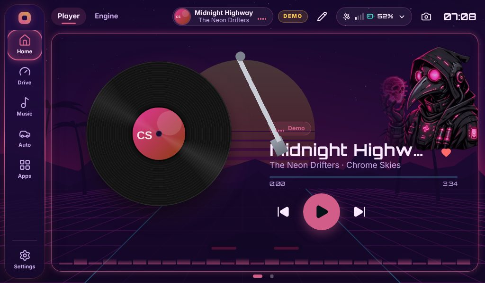

| | |
| --- | --- |
| 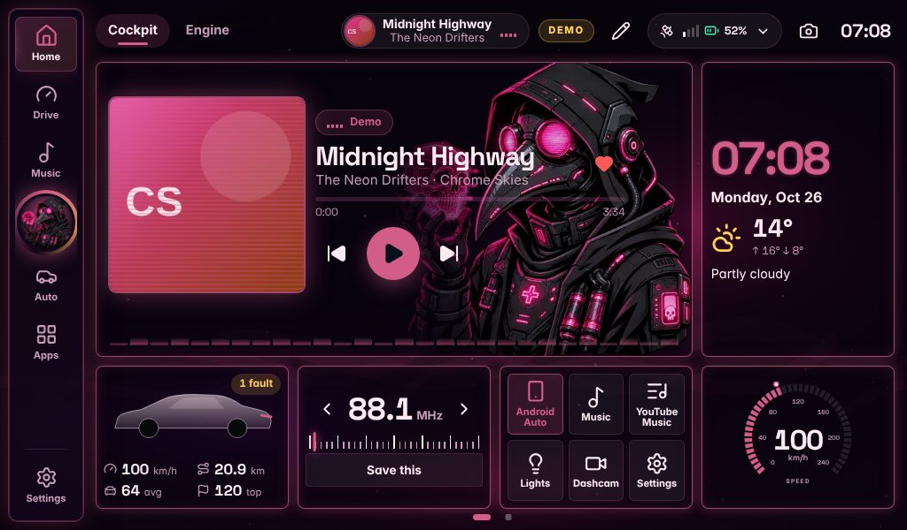 | 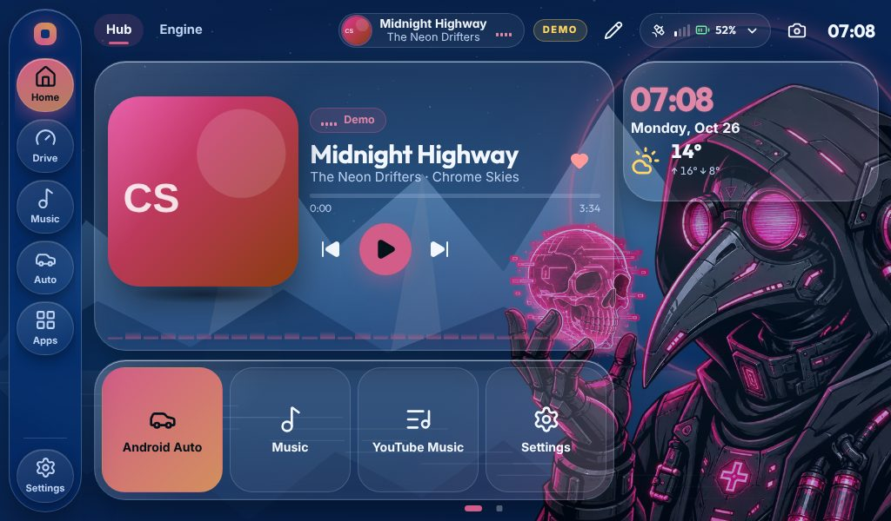 |
| 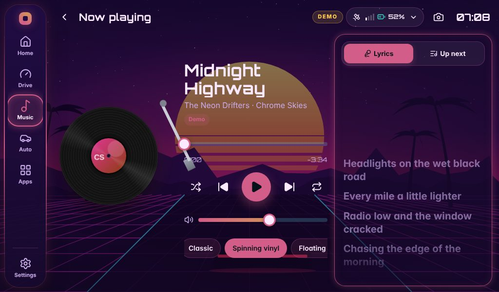 |  |
| 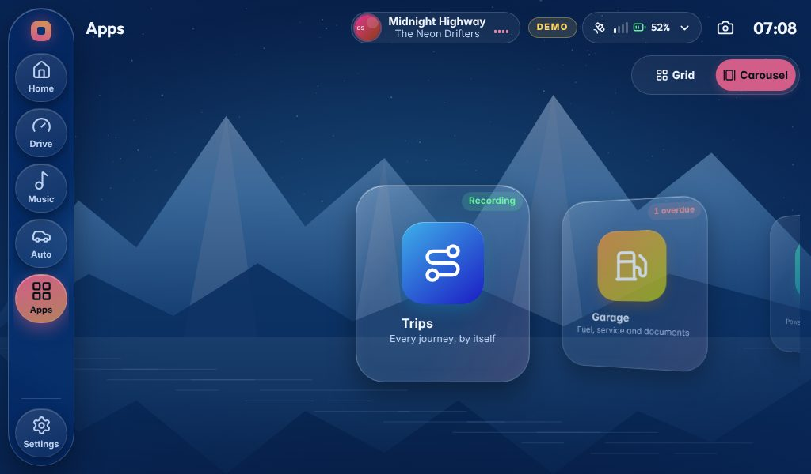 | 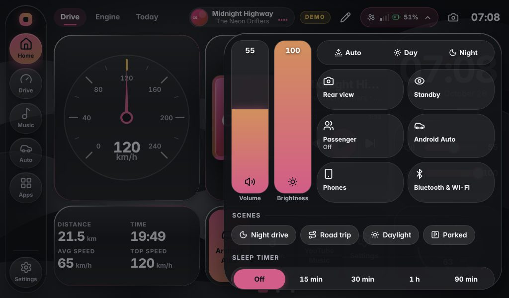 |

## Make it look the way you want

Pick a whole look in one tap, then change any single part of it. A look sets everything together, so nothing clashes: palette,
wallpaper, card style, depth, glass, motion, typeface, page transitions, gauges, the navigation bar's style and the mascot's motion
and light.

* **75 ready-made looks**: 6 featured (Retro Synthwave, Arctic Crystal, Phantom Pink, Liquid Chrome, Stealth AMOLED, Nature Drive),
  14 design styles (Neo Brutal, Holo Foil, Neon Noir, Toxic Lab, Miami Nights, Deep Dive…), 25 signature themes, v2's 16 3D scenes
  and v2's 14 looks.
* **My looks**: save any look under a name, wear it again in one tap, share it as a code, or let **Surprise me** put one together.
* **4 Home layouts**: Cockpit, Player focus, Glass hub and Classic. Every widget can still be moved, resized or removed.
* **44 palettes** with day/night switching by the clock or the real sunrise and sunset, and **any accent colour**, kept readable.
* **12 card styles** (from glass and chrome to brutalist, holographic and green-screen terminal), **7 depths, 6 glass finishes**,
  23 backgrounds, **26 built-in wallpapers** plus your own, and **24 animated scenes** (a highway at night, sakura, a radar, a storm…).
* **18 album-art styles** (spinning vinyl, CD, cassette, a turning cube, a record sliding out of its sleeve…), **11 page
  transitions**, 6 touch effects.
* **8 typefaces, 8 gauge styles** (including an LED race dash and a HUD), **9 standby screens** (Nixie tubes, a word clock, binary…).
* **12 navigation bar styles** on the left, the right or along the bottom, with an album or mascot medallion if you like.
* **9 music-reactive light styles**, driven by the real sound (never a made-up beat).
* **The mascot**: 3 artworks, 12 motions, 6 auras, anywhere on the screen.
* **Boot Studio**: the start-up screen, with 10 themes, 9 backgrounds, 8 mascot motions, 9 loaders, 7 letterings and 6 hand-overs.

| | |
| --- | --- |
| 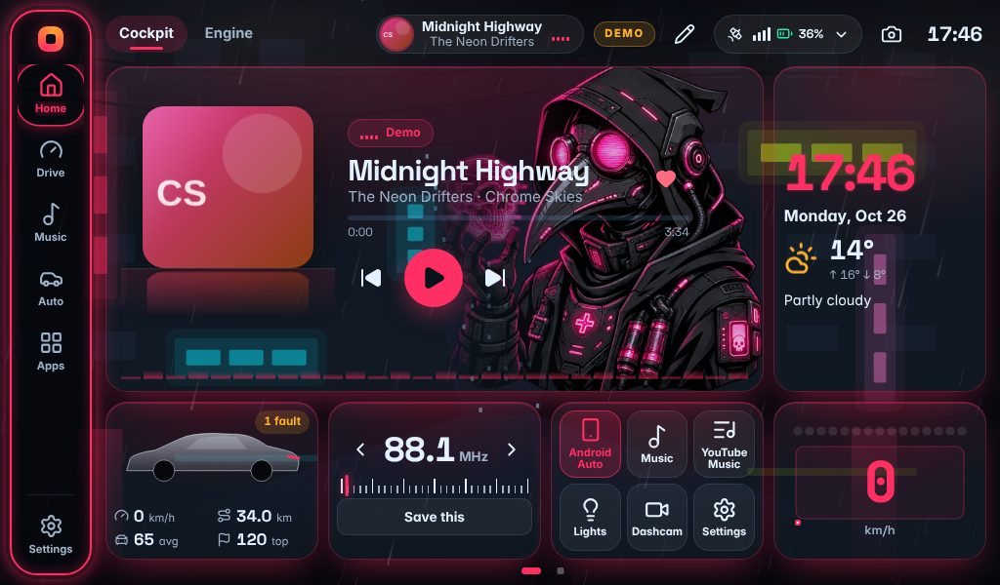 | 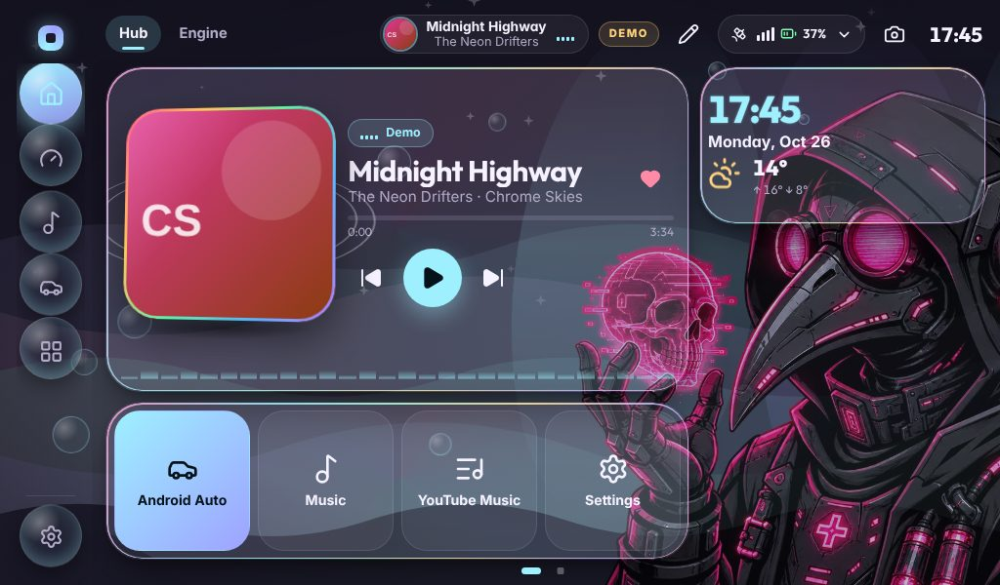 |
| 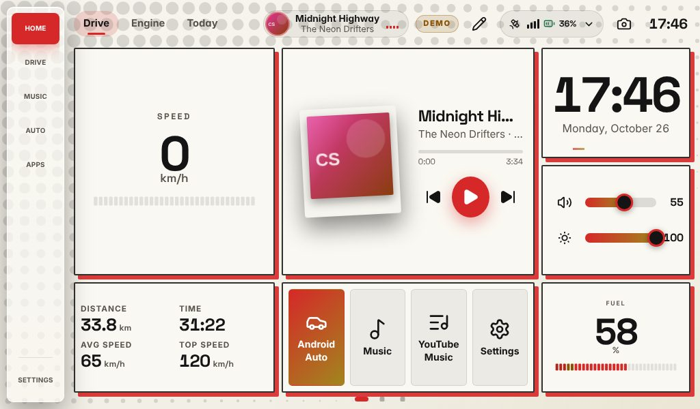 | 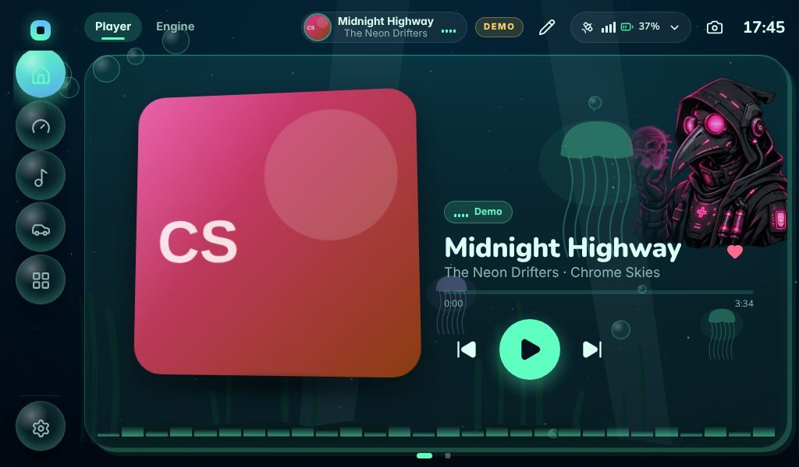 |

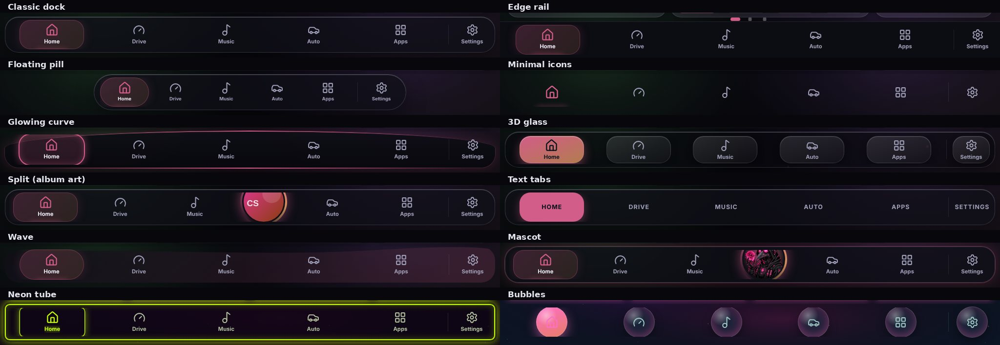

Guides: [themes and looks](docs/themes.md) · [3D effects and motion](docs/3d-motion.md) · [navigation](docs/navigation.md) ·
[mascot](docs/mascot.md) · [boot screen](docs/mascot-boot.md) · [music-reactive light](docs/music-reactive.md)

## Everything else it does

**Music.** Spotify, TIDAL and YouTube Music, internet radio with search and favourites, a music library, a full-screen Now Playing
with synced lyrics, and a sound output picker. Setup: [Spotify](docs/spotify.md) · [TIDAL](docs/tidal-setup.md) ·
[YouTube Music](docs/youtube.md) · [radio](docs/radio.md).

**The car.** Live OBD-II data and fault codes ([obd.md](docs/obd.md)), a Drive screen, a rear camera with guide lines, Bluetooth
phones, Wi-Fi, and wired Android Auto through an optional receiver ([android-auto.md](docs/android-auto.md)).

**FM transmitter.** Send the head unit's sound to the car's own radio through a second small Pi ([fm.md](docs/fm.md)).

**Apps** (19, opened from the Apps screen, as a grid or a 3D carousel):

| Group | Apps |
| --- | --- |
| Car | Trips · Garage · System · Find my car · Performance · Phones · Vehicle |
| Car Lab | GPS · Lights (WLED, which can match the screen's colour) · Dashcam · FM transmitter ([car-lab.md](docs/car-lab.md)) |
| Everyday | Scenes · Quick actions · Notes · Weather · Timers · Sleep sounds · Tools (converter, tip split, world clocks) |
| Play | Arcade (only while parked) |

**Home widgets** (29): speed, revs and any gauge, the music, radio presets, the FM tuner, the clock, weather, trips, the garage,
timers, scenes, quick actions, phones, a compass, a calendar, your saved looks, a sound meter of the real music level, and more. Drag,
resize and arrange them on as many pages as you like.

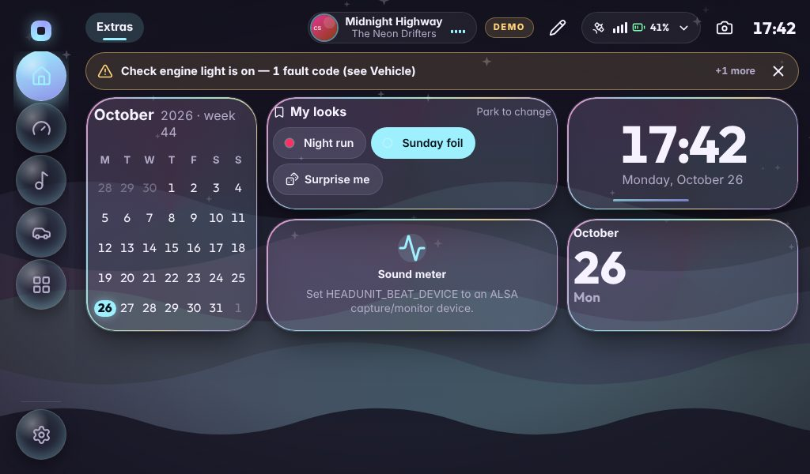

**Little things that matter in a car.** A trip survives the power being cut with the ignition. Timers live on the server and keep
running. Typing and parked-only apps lock above 8 km/h ("I'm a passenger" lifts it), and decorative animation stops while you drive.
The navigation, Quick Panel and Apps screen can be rearranged only while parked, and there is always a way back to Settings. Everything
that is yours can be saved to one file and restored in a tap (Settings → Backup & update).

## Screens

Laid out for **800×480, 1024×600 and 1280×400** touchscreens (and anything larger). Text and widgets size themselves to their space.

| 800×480 | 1280×400 |
| --- | --- |
| 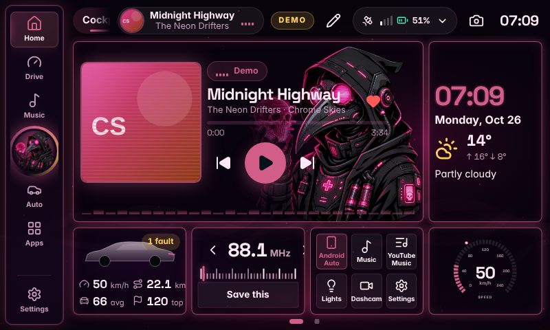 | 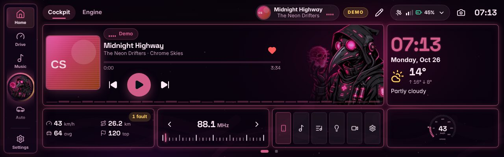 |
| 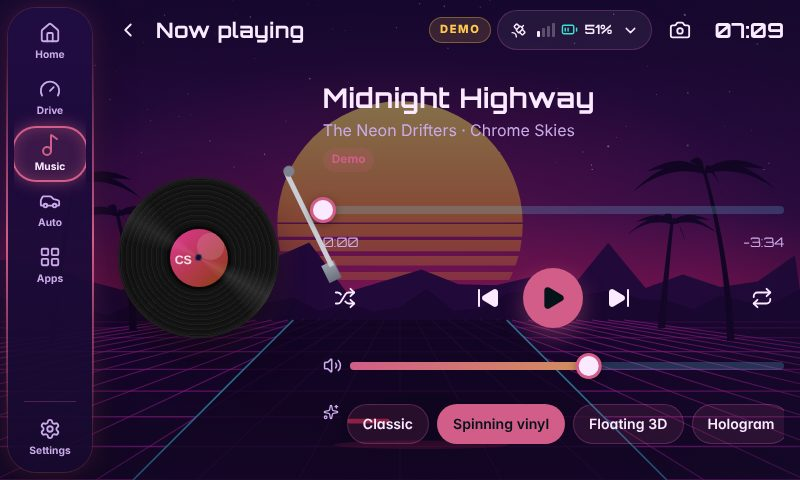 | 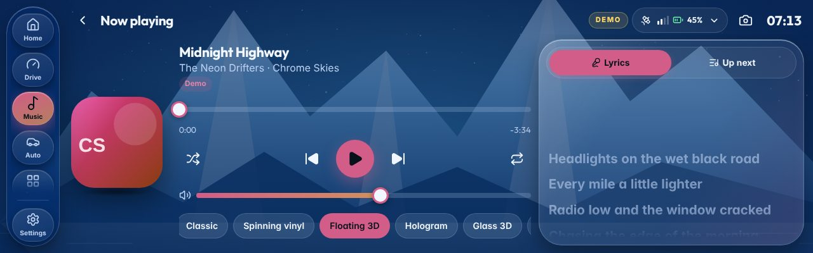 |

## Try it on a laptop

**On Windows, with your real Spotify, TIDAL, YouTube Music and radio:** install [Node.js](https://nodejs.org) (LTS), download this
project and double-click **`start-windows.cmd`**. The step-by-step guide, including setting up each music service, is
[docs/windows.md](docs/windows.md).

The rest of this section is the developer route (any system). Needs [Node.js](https://nodejs.org) **22.9 or newer**.

```sh
git clone https://github.com/Steveboy123/RootUnit && cd RootUnit
npm install
npm run dev
```

Open **http://127.0.0.1:5173**. The app is shown inside a frame at an exact car-screen size (pick one at the top, or add `?noframe`).

`npm run dev` starts **demo mode**: a simulated car driving a loop, phones, sound outputs, a music library, GPS, weather and lyrics,
all offline. The screen shows a **DEMO** tag, and demo data is kept apart in `data-demo/`. Demo mode is switched on only by the
`--demo` command-line flag, so it can never start in a real car by accident.

```sh
npm test            # server + UI tests
npm run typecheck   # all three packages
npm run build       # production build
npm start           # the built app on http://127.0.0.1:8787 (real hardware only)
npm run dev:live -w @headunit/server   # the server against real hardware, with the dev UI
```

## Install on a Raspberry Pi 5

On Raspberry Pi OS 64-bit (Trixie recommended), from the project folder:

```sh
sudo ./install.sh
```

It installs Node.js 22 and the system packages, builds the app, sets up `headunit.service` and the Chromium kiosk, and keeps your
`.env` and `data/`. Full steps and the hardware list: [docs/pi-setup.md](docs/pi-setup.md). The animated boot screen is an optional
extra step: [docs/mascot-boot.md](docs/mascot-boot.md).

**Coming from v2?** RootUnit is version 3.0.0, built to install as an update over v2 (not yet tried on a Pi): your settings, sign-ins, wallpapers, garage, trips
and radio stations carry over, every v2 look is still there, and v2's *Liquid Chrome* scene is now called *Silver Grid*.

**Updating:** `npm run package` builds `RPI-head-unit-v<version>-RootUnit.zip` from the committed files. On the Pi, put it in
Downloads and use **Settings → Backup & update → Software update**. The old version is kept as a rollback point.

## Privacy

The head unit works with **no internet**. Only these reach out, and each is a switch:

| Feature | Sends | To | Default |
| --- | --- | --- | --- |
| Weather | the car's position, rounded to about 1 km | open-meteo.com | on · Settings → General → Online extras |
| Lyrics | the song's title, artist, album and length | lrclib.net | off · Settings → General → Online extras |
| Spotify, TIDAL, YouTube Music | what those services need to play your music | the services | only if you sign in |
| Quick actions | the request you set up | the address you set, on your own network | none set up |

It listens on loopback only and has no login; see [docs/pi-setup.md](docs/pi-setup.md) before exposing it.

## Honest status

Built and tested **without a Raspberry Pi, a car or any of the hardware**: about 4,000 automated tests (server, UI and shared rules)
and browser runs of every screen against the demo at the three screen sizes. The performance rules below are enforced by tests, but
**smoothness has not been measured on a real Pi**, and the music services, OBD-II, GPS, lights, dashcam, Android Auto and FM have not
been run against real hardware or live accounts. Start with Effects → *Balanced* and Motion → *Calm* on the Pi, and try the heavier
looks once you have seen how your screen copes.

## How it's built

```
packages/shared   Settings, layout and protocol types and validation shared by the UI and the server
apps/server       Node 22: HTTP + WebSocket hub, JSON storage, providers (OBD-II, BlueZ, PipeWire, radio, music), feature modules,
                  and demo/ (the simulation, only with --demo)
apps/ui           React 19 + Vite + zustand: shell, pages, apps, widgets, the theme engine (lib/themes) and styles/
deploy/           systemd unit, kiosk, boot screen, installers for the Pi
docs/             guides for every part
```

**Design rules**, enforced by `apps/ui/src/styles/policy.test.ts` across every stylesheet: only `transform` and `opacity` animate;
nothing transitions layout; `filter` only on the background layers; `backdrop-filter` only through one token that is off below
*Full* effects; every CSS variable is defined; every animation names a keyframe that exists; decorative motion stops while driving.
Touch targets are at least 44 px, an unavailable reading shows a dash rather than a made-up value, and the interface loads nothing
from the internet.

## More documentation

[Pi setup](docs/pi-setup.md) · [Windows](docs/windows.md) · [Music services setup](docs/setup.md) · [Car Lab](docs/car-lab.md) · [API](docs/api.md) ·
[Ideas](docs/ideas.md) · [Changelog](docs/changelog.md)

## Licence

See [LICENSE](LICENSE).
