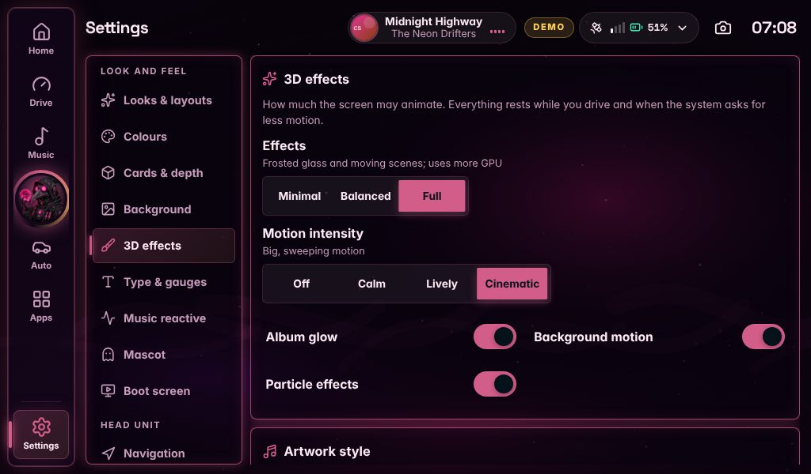
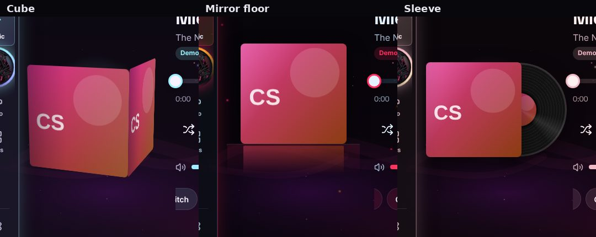

# 3D effects and motion

Every effect is drawn by the real interface with CSS 3D transforms and animations. There is no WebGL, no video and no extra graphics
process, so it runs on the Pi 5's own GPU without anything else installed. None of it touches the audio or the FM transmitter.

## Where to find it

| Setting | Where | Choices |
| --- | --- | --- |
| **Effects** | Settings → 3D effects | Minimal (no blur, no animation) · Balanced (one soft blur, gentle motion; the default) · Full (frosted glass and moving scenes) |
| **Motion intensity** | Settings → 3D effects | Off · Calm · Lively · Cinematic |
| **Album glow** | Settings → 3D effects | The coloured light behind the cover, on or off |
| **Background motion** | Settings → 3D effects | Freezes the wallpaper and scene when off, keeping everything else |
| **Particle effects** | Settings → 3D effects | A quick switch for the *Particles* scene |
| **Artwork style** | Settings → 3D effects, or the chips under the player on Now Playing | 18 styles (below) |
| **Page transition** | Settings → 3D effects | Instant · Fade · Slide · Rise · Zoom · Flip · Depth · Swing · Cube · Drop · Tilt · Portal |
| **When you touch** | Settings → 3D effects | None · Ripple · Glow · Pop · Sparkle · Ring · 3D press |
| **Depth** | Settings → Cards & depth | Flat · Soft · Deep · Crystal · Floating · Bevel · Layered |
| **Glass finish** | Settings → Cards & depth | Clear · Frosted · Prismatic · Iridescent · Smoked · Liquid |
| **Animated scene** | Settings → Background | 24 scenes behind the Home widgets, and how busy they are |
| **Navigation style** | Settings → Navigation → Edit navigation… → Look | 12 styles; the highlight slides between buttons, the album or mascot medallion turns, the neon tube hums and the bubbles bob |
| **Mascot** | Settings → Mascot | 13 motions (Bounce and Drift are new) and 7 auras (Rings and Aurora are new) |

Every featured look, signature look and 3D scene sets these together so they match (see [themes.md](themes.md)); any of them can be
changed on its own afterwards.

## Artwork styles

Used on Home, Now Playing and the Music players. The cover only moves while something plays.

| Style | | Style | |
| --- | --- | --- | --- |
| Classic | the plain cover | Compact disc | a shiny disc |
| Spinning vinyl | a record that turns while it plays | Cassette | a tape with turning reels |
| Floating 3D | the cover hovers and tilts | Parallax tilt | leans as it plays |
| Hologram | projected above a glowing ring | Stack | a pile of sleeves |
| Glass 3D | the cover behind glass | Breathe | swells with the music |
| Orbit | rings circle the cover | Polaroid | an instant photo |
| Prism | rainbow edges | Glitch | digital tears |
| Cube | the cover on a cube that turns a quarter at a time | Flip | turns over now and then |
| Mirror floor | stands and bobs over its own reflection | Sleeve | the record slides out of its sleeve and turns |

**New transitions and touches in 3.1:** *Cube* turns the next screen in like a cube's face, *Drop* drops it in with two small bounces,
*Tilt* tips it forward into place and *Portal* spins it out of a point of light. *Sparkle* throws sparks from your finger, *Ring* sends
a ring of light out past the button, and *3D press* sinks the button in like a real key.

**New scenes in 3.1:** *Highway* (road lines and street lamps rushing past), *Sakura* (petals tumbling), *Embers* (sparks rising from
a glow), *Radar* (a sweeping scope with blips), *Skyline* (a city at night with windows going on and off, a beacon and a plane) and
*Storm* (rain, cloud and distant lightning: a soft flicker a few times a minute, far below anything that could trouble
light-sensitive eyes, and like every scene it stops while you drive).

## Safety and the Pi

* Only `transform` and `opacity` animate, so the GPU does the work and nothing is laid out again. A test (`styles/policy.test.ts`)
  fails the build if any stylesheet breaks that rule.
* **While the car moves** (above 8 km/h), the scenes, the mascot, the glass sheen and every other decorative animation stop. Only the
  turning record or CD and the music equaliser keep going, because they show that music is playing. Widgets never move.
* *Effects → Minimal*, *Motion intensity → Off* and the system's *reduce motion* setting each stop all decorative motion.
* The real frosted `backdrop-filter` is used only at *Full*; *Balanced* fakes glass over one blurred background layer.
* On a Pi 5, start with **Balanced** and **Calm**. Try **Full** and **Cinematic** once you have seen how your screen copes.

This was built and checked in a browser at 800×480, 1024×600 and 1280×400, not on a Pi. How smooth it is on the real screen is the
first thing to look at.
