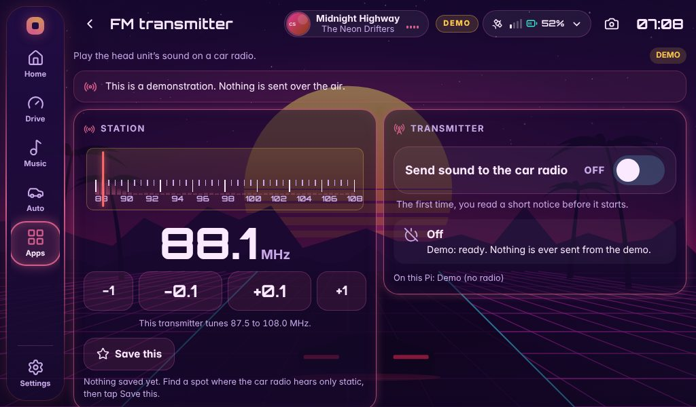

# FM transmitter: play the head unit's sound on a car radio

The head unit can send what it is playing out as a **very weak FM signal**, so a car radio with no input socket or Bluetooth can play
it: tune the radio to a free frequency, switch the transmitter on, and the music comes out of the car's speakers.

It uses [markondej/fm_transmitter](https://github.com/markondej/fm_transmitter), which turns one of a Raspberry Pi's pins into a tiny
FM transmitter. Its source is included, unchanged, in `vendor/fm_transmitter` (BSD licence, see the end of this page).



## Read this first

* **Transmitting radio is regulated almost everywhere.** In some countries it needs a licence; in others it is allowed only at very low
  power, and only on some frequencies. You are responsible for following the rules where you drive. The head unit asks you to accept
  this notice before anything is sent, and it is off until you do.
* This sends a weak signal from a short piece of wire. It is **not filtered** and is meant to reach only your own car. Do not add an
  amplifier or a longer antenna.
* Pick a frequency with **no station on it**: tune the car radio across the whole band first, and choose a quiet spot. Never use a
  frequency that someone could be relying on.
* The sound is **mono**, about **11 kHz wide**, with no RDS (no station name), and arrives **one to two seconds late**. A cable or Bluetooth
  to the car sounds better whenever you have one.

## Why it needs a second Pi

`fm_transmitter` works by driving the Pi's clock hardware directly, and that hardware is different on the **Pi 5**. Its own README says it works on
"Raspberry Pi boards up to 4 (RPi 5 uses different peripheral chip)". Worse, if it does not recognise the board it falls back to an old
address and writes there as root, which on a Pi 5 would be the wrong place. So this head unit **never starts the program on a Pi 5, or on any
board it does not positively recognise.**

So the transmitter runs on a small helper on a Pi that can do it, and the head unit sends its sound there:

| You have | Do this |
| --- | --- |
| A head unit on a **Pi 5** (what this project is built for) | Put a second, cheap Pi next to it as the transmitter: a **Zero 2 W**, 3 or 4 (an older Zero or Pi 1 or 2 also works). Follow *Setup with a second Pi*. |
| A head unit that is itself a **Pi 4 or older** | The helper can run on the same Pi. Follow *Setup on the same Pi*. |

```
  head unit                                                  the Pi that transmits
 ┌───────────────────────────┐   control  :8788 (HTTP)   ┌───────────────────────────────┐
 │ FM app  →  the server     │ ─────────────────────────►│ headunit-fm-node (the helper) │
 │ records what it is playing│   sound    :8789 (raw)    │  checks, paces, adds a header │
 └───────────────────────────┘ ─────────────────────────►│  → fm_transmitter → wire      │
                                                          └───────────────────────────────┘
```

## Setup with a second Pi

You need the second Pi (with Raspberry Pi OS and a network connection to the head unit), about 30 cm of plain wire, and a car radio.

1. **Copy the project folder to the second Pi** (the whole folder; it needs `deploy/` and `vendor/fm_transmitter/`), for example
   `scp -r rpi-head-unit pi@fm-pi.local:`.
2. **On the second Pi** run the installer. It checks the board, builds the transmitter program from the included source (no internet
   needed once `build-essential` and `python3` are installed), installs the helper as a system service and prints a password:

   ```sh
   cd rpi-head-unit
   sudo ./deploy/setup-fm.sh node
   ```

   Add `--gpio21` on a **Pi 4** (see *The antenna*). The installer refuses a Pi 5 or any board it does not know, before it changes anything.
3. **On the head unit**, add the two lines the installer printed to `.env` (in the project folder), then restart the head unit
   (`sudo systemctl restart headunit`):

   ```
   FM_NODE_URL=http://192.168.1.50:8788      # the second Pi's address
   FM_NODE_TOKEN=the-long-password-it-printed
   ```
4. **Connect the antenna** (below), open **Apps → FM transmitter**, choose a free frequency, accept the notice, and switch **On**.
   Tune the car radio to the same frequency.

### How the two Pis reach each other

Any network both are on works: the same Wi-Fi (a phone hotspot, for example), a network cable, or a USB link between a Zero and the head unit.
The helper answers on port **8788** (control) and **8789** (sound). **Both are plain, unencrypted TCP**, protected by the password only, so use a
network you trust, and do not expose them to the internet. Even with the password, the helper never goes outside the band you allow and never
sends if the head unit goes quiet (see *What keeps it safe*).

## Setup on the same Pi

Only for a head unit that is a **Pi Zero, 2, 3 or 4**:

```sh
cd rpi-head-unit
sudo ./deploy/setup-fm.sh local        # add --gpio21 on a Pi 4
sudo systemctl restart headunit
```

It listens only on the Pi itself, and it adds `FM_NODE_URL` and `FM_NODE_TOKEN` to `.env` for you (it never overwrites what is there).

## The antenna

About **20 to 40 cm of plain wire** (a jumper wire is fine) on:

| Board | Pin | Install with |
| --- | --- | --- |
| Pi Zero, 1, 2, 3 | GPIO4, header pin **7** | `setup-fm.sh node` |
| Pi 4 | GPIO21, header pin **40** | `setup-fm.sh node --gpio21` |

On a **Pi 4**, other parts of the chip disturb the signal on GPIO4. The transmitter's author recommends GPIO21, a **fixed** CPU speed
(`echo powersave | sudo tee /sys/devices/system/cpu/cpu0/cpufreq/scaling_governor`; the helper does not change this for you), and frequencies
**below 93 MHz**.

(`make GPIO21=1`, as the transmitter's own README says, does nothing in the version included here: the Makefile never uses the option.
The installer passes the setting in a way that works.)

## Using it

* **− / +** change the frequency by 0.1 MHz, **−1 / +1** by a whole MHz. Taps are sent together a moment after the last one, so the signal
  does not sweep across every frequency in between while it is on the air.
* **Save this** keeps up to six favourite frequencies as buttons.
* The **level bar** shows the loudness being sent. If it does not move while music plays, the head unit is not capturing its sound.
* Switching on starts sending after about a second and a half. Pausing, skipping and volume changes reach the radio one to two seconds late.
* The head unit's own volume sets how loud the radio is. Keep it high enough that the radio does not hiss, but not clipping.
* The transmitter stays on after a restart if you left it on, and it stops when you switch it off.

## What keeps it safe

* **Off until you accept the notice**, per head unit. The notice changes only when its meaning does.
* **The program only ever starts on a board it recognises** (Zero, Zero W, Zero 2 W, Models A/B and A+/B+, Pi 2, 3, 4, 400, Compute Module 1, 3, 3+, 4).
  A Pi 5, a Pi 500, a Compute Module 5, a future board, an unreadable board and a PC are all refused, and the program is not run.
* **The helper does the checking**, not the program (which checks nothing): the frequency must be in the band (87.5 to 108.0 MHz unless you
  narrow it; never outside 76 to 108), and the swing at most 150 kHz (100 by default).
* **A dead-man timer**: if the helper hears nothing from the head unit for 30 seconds, it stops transmitting. A head unit that crashes, loses
  power or loses the link never leaves a transmitter on the air.
* **The password** is kept in `.env` on the head unit and in `/etc/headunit-fm-node.conf` (readable by root only) on the transmitter Pi.
  It is never shown on screen, kept in settings or a backup, or written to a log.
* Silence is sent when nothing is playing (the program stops after a second of nothing, so the helper keeps it fed). The carrier stays on
  while the switch is On.

## Settings of the helper

`/etc/headunit-fm-node.conf` on the transmitter Pi (after a change: `sudo systemctl restart headunit-fm-node`):

| Setting | Meaning | Default |
| --- | --- | --- |
| `TOKEN` | the password (at least 16 characters, no spaces); `setup-fm.sh` makes one | made for you |
| `BIND` | network address to listen on (`127.0.0.1` = this Pi only, `0.0.0.0` = every network) | `0.0.0.0` for `node`, `127.0.0.1` for `local` |
| `CONTROL_PORT`, `AUDIO_PORT` | the two ports | 8788, 8789 |
| `FREQ_MIN`, `FREQ_MAX` | the band it accepts; narrow it to what is free where you drive | 87.5, 108.0 |
| `BANDWIDTH_MAX` | widest swing it accepts, in kHz (never above 150) | 150 |
| `DMA` | the transmitter program's DMA channel | 0 |
| `DEADMAN_S` | seconds of silence from the head unit before it stops | 30 |

On the head unit, `.env` holds `FM_NODE_URL`, `FM_NODE_TOKEN`, and optionally `FM_NODE_AUDIO_PORT` (8789) and `FM_AUDIO_SOURCE`
(default `@DEFAULT_MONITOR@`: whatever the head unit is playing; `parec` must be installed: `sudo apt install pulseaudio-utils`).

## When something is wrong

The page says what is wrong in plain words. The usual causes:

| The page says | Check |
| --- | --- |
| *Not set up* | `FM_NODE_TOKEN` is missing from `.env`, or `FM_NODE_URL` is not an `http://` address. Restart the head unit after changing it. |
| *Can't reach the helper* | On the transmitter Pi: `sudo systemctl status headunit-fm-node`. Is the address right? Are both Pis on the same network? Try `curl -H "Authorization: Bearer YOUR-TOKEN" http://ADDRESS:8788/v1/status`. |
| *Password does not match* | `FM_NODE_TOKEN` in the head unit's `.env` must equal `TOKEN` in `/etc/headunit-fm-node.conf`. |
| *Not available on this board* | The helper is on a Pi 5 or an unknown board. Use a second Pi. |
| *Update the FM helper* | The head unit and the helper are different versions: run `setup-fm.sh node` again on the transmitter Pi, from the same project version. |
| *The transmitter program stopped* | `sudo journalctl -u headunit-fm-node -n 30` on the transmitter Pi (a permissions or `/dev/mem` problem shows up there). |
| *Sound capture is missing* | `sudo apt install pulseaudio-utils` on the head unit. |
| On the air, but nothing on the radio | A free frequency? The wire connected to the right pin (7, or 40 with `--gpio21`)? The radio close enough (a few metres at most)? |
| Hissing, or another station breaks through | Try another frequency. On a Pi 4 use GPIO21, a fixed CPU speed and a frequency below 93 MHz. |

## Updating and removing

* After a head unit update, if the release notes say the helper changed, run `sudo ./deploy/setup-fm.sh node` (or `local`) again from the new version. It
  keeps the password and settings.
* To remove it: `sudo ./deploy/setup-fm.sh uninstall` (add `--purge` to remove the password file as well).

## What was and was not tested

Built and tested **without a Raspberry Pi, a transmitter, a radio or a car**. What is tested:

* the helper and the head unit's side, end to end over real network sockets, with a stand-in for the transmitter program;
* that the stream the helper feeds the program is accepted by the program's own reader (the real `wave_reader.cpp` from the included source, compiled and fed by the live helper);
* that the installer builds the included source and installs it, and that every refusal (Pi 5, unknown boards, damaged source) happens before anything is changed.

What is **not** known: whether the program drives the pin correctly on your board, how far the signal reaches, the real start-up delay, and the sound
quality. Please try it on the bench with the radio next to the Pi first.

## Licences and credit

`fm_transmitter` is by Marcin Kondej (BSD 3-clause); `mailbox.c` and `mailbox.h` are by Broadcom (BSD 3-clause). They are included in
`vendor/fm_transmitter` exactly as published, at the commit named in `vendor/fm_transmitter/SOURCE.txt`, with their notices in `NOTICE`. The
idea of using the Pi's clock output as an FM transmitter comes from Oliver Mattos and Oskar Weigl's PiFM.
