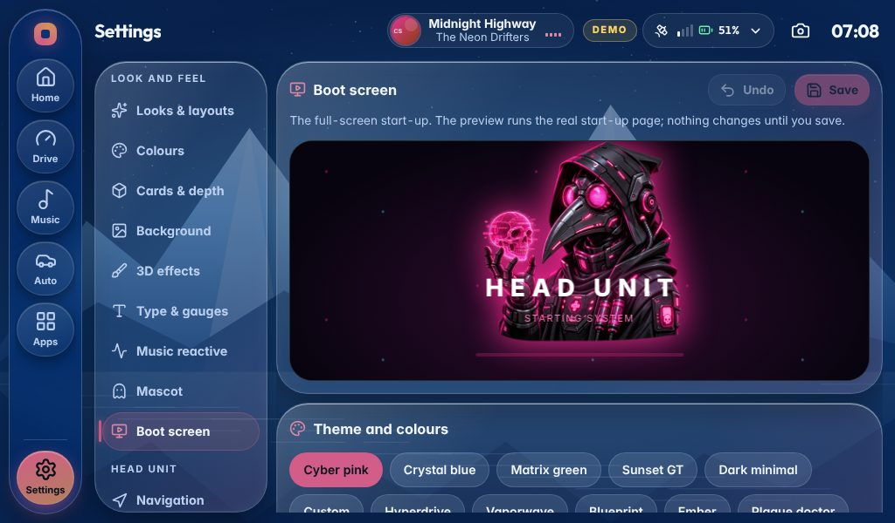
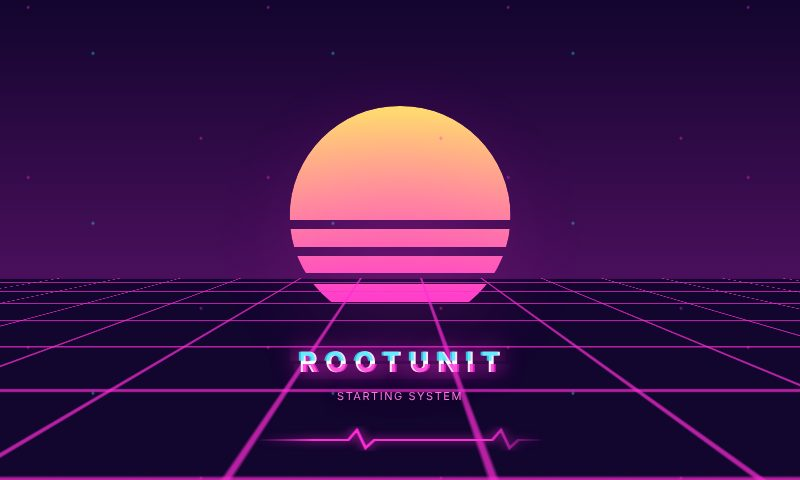
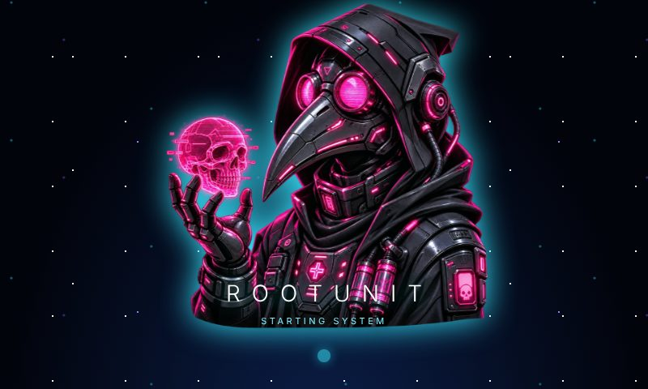
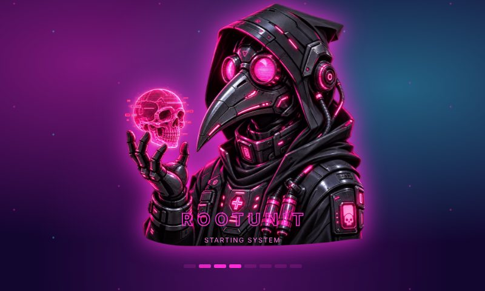
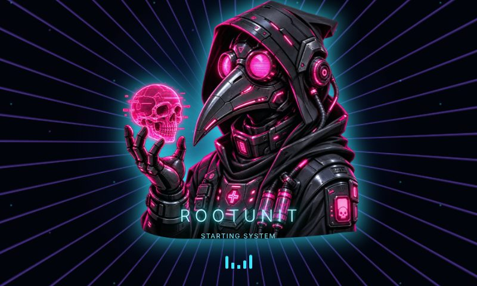

# Mascot boot experience — Raspberry Pi 5 (v2.8.1)

This version includes **two real startup stages** that share the same neon-pink plague-doctor mascot:

1. **Early Linux boot:** optional Plymouth splash shows the mascot, a dark screen and a gentle glow pulse. This happens before the Chromium browser exists.
2. **Full-screen kiosk loading:** Chromium starts immediately on a **local HTML** animation (`deploy/boot/loading.html`). It stays there until the actual Node backend reports that the built head-unit interface exists, then navigates directly to the UI. The React app displays its own matching mascot loading state while waiting for its live WebSocket snapshot. There is no artificial progress percentage or timed dismissal.

## Enable the no-desktop boot mode

**First** finish installing v2.8.1 using the software updater or `sudo ./install.sh` and confirm that the head unit runs normally. Enable SSH before switching the login session, so you have a recovery path if the Pi screen fails.

From the actual installed project directory on the Pi:

```bash
sudo ./deploy/setup-boot-experience.sh enable "$USER"
sudo reboot
```

The script installs a new `headunit-kiosk` LightDM session and changes **only the autologin session**, not your normal Pi OS session or installed desktop packages. The new session starts a separate labwc compositor that contains **no desktop, panels or wallpaper**, only the head unit. It automatically restarts Chromium if the browser exits. Existing dashboard touch and audio services are retained. The dedicated session is only supported on **Raspberry Pi OS Desktop with LightDM + labwc**; verify before enabling.

`enable` also installs the Plymouth theme and adds `quiet splash loglevel=3 vt.global_cursor_default=0 logo.nologo` to the current `cmdline.txt`. It backs up the original login and kernel command line configuration. A Raspberry Pi firmware splash may still appear for a moment *before* the kernel and Plymouth have started, and there can be a brief black handoff as the graphics compositor takes ownership of the display. The system cannot guarantee an absolutely continuous image on every display, but **the Raspberry Pi OS desktop is not launched**.

## Roll back to the ordinary desktop

From SSH or a text console (usually Ctrl+Alt+F2):

```bash
cd /path/to/your/RPI-head-unit-project
sudo ./deploy/setup-boot-experience.sh disable
sudo reboot
```

To check status:

```bash
./deploy/setup-boot-experience.sh status
sudo systemctl status headunit
sudo journalctl -u headunit -n 60 --no-pager
```

If the app does not finish loading, the boot animation **keeps showing** with a helpful message after roughly one minute; it does not switch to the desktop. Logs: `~/.local/state/rpi-headunit/chromium.log` and `sudo journalctl -u headunit`.

**Important:** A regular head-unit ZIP update only replaces project files; it **does not** silently change the system boot/login setup. The one-time `enable` command is required. Re-running the setup can restore the desktop in case of problems. Avoid deleting the project's installed directory while this kiosk session points at it.

## What is customizable?

The early Plymouth screen and local HTML use the included `deploy/boot/plymouth-mascot.png` and `deploy/boot/mascot.png`; they can be replaced with an image of the same name. **Settings → Mascot** still controls the animated mascot inside the main UI, independently. Because boot runs before saved UI settings and audio exist, boot colour and motion are intentionally separate from the live UI theme and cannot respond to music until the head-unit application starts.

## Boot Studio

Open **Settings → Boot screen**. The preview is the real loading page running in a safe frame, so what you see is what the car shows.
Nothing changes until you tap **Save** (**Undo** goes back to what is saved). Settings are kept in `data/boot-studio.json`; uploaded
pictures in `data/boot-assets/`, and both survive software updates.



| | |
| --- | --- |
| **Theme** | Cyber pink · Crystal blue · Matrix green · Sunset GT · Dark minimal · Hyperdrive · Vaporwave · Blueprint · Ember · Plague doctor, or Custom with your own four colours |
| **Background** | Solid · Gradient · Aurora · 3D grid · Stars · Warp speed · Colour mesh · Synth sun · Your photo; darken; floating glow particles |
| **Mascot** | Original · Neon cut-out · 3D armour · your upload; position, size, visibility, neon glow, mirror |
| **Mascot motion** | Still · Float · Pulse · 3D tilt · Orbit · Hologram · Glitch · Breathe · 3D spin, and its speed |
| **Words** | the title, what it says while loading and when ready, and the lettering: Wide · Clean · Terminal · Neon · Glitch · Outline · Future |
| **Progress** | Sliding bar · Neon ring · Pulse dots · Laser scan · Pulse · Wave · Segments · Orbit · Heartbeat · Hidden. It never shows a made-up percentage: it runs until the head unit answers |
| **Into the dashboard** | Instant · Fade · Zoom · Slide · Iris · Warp · Shutter, and how long the hand-over takes |

| | |
| --- | --- |
|  |  |
|  |  |

Older saved designs keep working: every v2 choice is still there under the same name.

Important: if `sync` tells you the mascot kiosk is not enabled, run `sudo ./deploy/setup-boot-experience.sh enable "$USER"` FIRST and reboot. `sync` is only for refreshing Plymouth after you have enabled the session.

Once saved, the HTML boot loading screen uses these settings on the next start **without an extra command**. To apply the supported subset (colors, mascot, position, title and simple animation) to the even earlier Linux/Plymouth splash, run:

```bash
sudo apt install python3-pil
sudo ./deploy/setup-boot-experience.sh sync
```

Plymouth cannot reproduce Chromium's rich HTML/CSS animations. It is a coordinated early image, followed by the full animated loader. Neither stage displays a fabricated progress percentage. The app's dashboard theme is independently customizable. There is no music meter available before boot.

For safety, saving Boot Studio settings never alters LightDM or OS startup files; only `enable`, `sync` and `disable` do that via sudo. Custom uploads must be PNG, JPG or WebP at most 6 MB.

## v2.8.3: blank screen / labwc menu on the first boot

If the Pi initially shows a black screen with **Terminal**, **Reconfigure**, and **Exit**, but the head unit appears when logging in a second time, the dedicated compositor is running and Chromium is not reliably opening on its first attempt. This release adds a supervised Chromium launcher, a dedicated Chromium profile to avoid the normal desktop process singleton, and a second `labwc -s` startup path if the compositor skips its autostart on cold boot.

1. While the head unit is accessible (you may need to Exit and log in once), install the update in Settings → Backup & update → Software update.
2. Open a terminal **in the installed project directory** (not inside the ZIP) and run `sudo ./deploy/setup-boot-experience.sh repair`.
3. Reboot with `sudo reboot`.

**Why is the repair command needed?** ZIP updates replace app files but cannot automatically rewrite root-owned LightDM, Wayland session, or Plymouth files. `repair` is designed for already-enabled mascot kiosks: it keeps the original boot backups, previous user configuration, `.env`, saved themes, and Spotify/TIDAL logins. It refreshes the mascot splash and sets the LightDM autologin to the repaired dedicated kiosk session.

If the first login is still blank, collect a startup report: `sudo ./deploy/diagnose-boot.sh`. Logs are also at `~/.local/state/rpi-headunit/labwc-session.log`, `kiosk-supervisor.log`, and `chromium.log`. The Pi's exact logs are needed to distinguish a compositor race, browser crash, or Plymouth theme/initramfs problem. **Do not post login tokens or any credentials from logs.**

To restore the normal Pi OS desktop and keep the head-unit files intact:

```bash
sudo ./deploy/setup-boot-experience.sh disable
sudo reboot
```

If it was never enabled, use `sudo ./deploy/setup-boot-experience.sh enable "$USER"` instead of `repair`. Chromium splash is a real local HTML file shown by the browser; Plymouth displays the early still/limited animation. A brief transition can still occur when control of the display passes from Plymouth to Wayland, depending on the display and Pi OS firmware.
