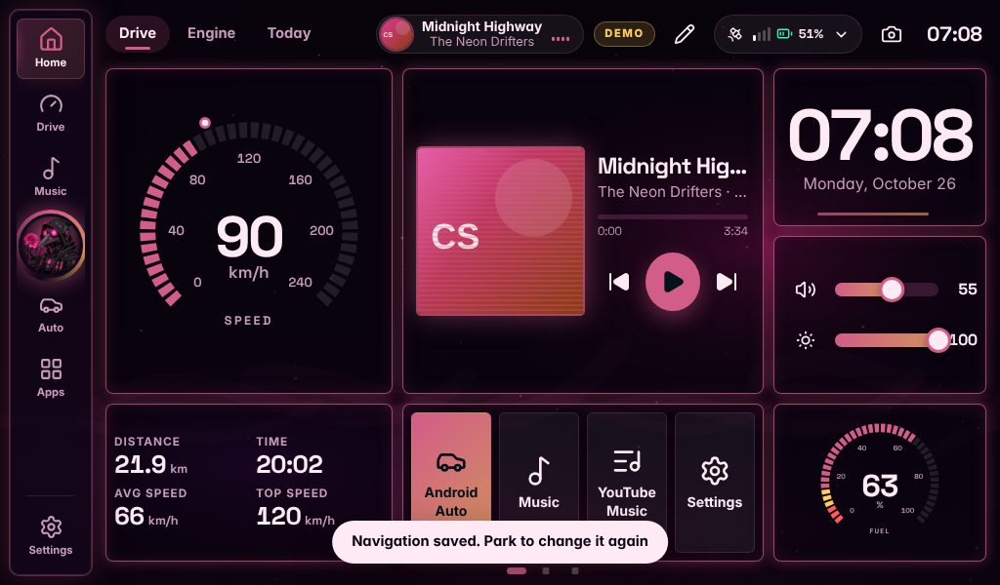

# Customising the navigation

The navigation bar is yours to arrange: which buttons, in what order, what they are called, what they look like, whether it sits on
the left, the right or along the bottom, which of twelve styles it has, and how big it is. The same goes for the Quick Panel, the Apps screen and the order of
the dashboard pages.

## Opening the editor

Any of these:

* **Hold any button on the navigation** for about a second. The button fades a little while you hold, so you can let go if you did not
  mean it. (A tip says so once, a few seconds after the first start.)
* **Settings → Navigation → Edit navigation…**
* **Quick Panel → Edit navigation**, the last button of the row along the bottom.
* **Apps → hold a tile → Add to navigation** puts that app on the navigation without opening the editor.

The editor is a panel on the side of the screen **away** from the navigation, so the navigation itself stays uncovered and shows every
change at once. Changes are saved a moment after you make them, and always when you close the panel.

## What you can change

**Items tab**

| | |
| --- | --- |
| **Add** | pages (Home, Drive, Music, Android Auto, Apps), any app, a music tab (Spotify, TIDAL, YouTube Music, Radio), a scene, a quick action, or a divider |
| **Order** | the up and down arrows on each row. A button can cross the *Pinned* line |
| **Name** | tap a row. Up to 10 characters; empty means the usual name |
| **Picture** | tap a row, then choose one of 42 pictures (or "usual") |
| **Remove** | the bin on the row, or inside the row's own screen |
| **Pinned** | up to 2 buttons sit below the line next to Settings and never scroll away; the rest scroll if they do not fit. The line shows where the scrolling starts on this screen |

There is room for 8 buttons besides Settings. **Settings is always there and always last.** It cannot be removed, renamed or moved,
and that is deliberate: it is the way back to everything else.

**Look tab**

| | |
| --- | --- |
| **Where** | left, bottom or right. Along the bottom the bar runs across the screen and the page sits above it |
| **Style** | twelve styles, each shown live on your own buttons (below) |
| **Size** | small, medium, large (the buttons are never smaller than 44 px) |
| **Names under the pictures** | always, current page only, never |
| **Ready-made** | *Default*; *Minimal* (Home, Music, Auto, names on the current page only); *Driver* (Drive, Music, Auto, large, names on the current page only). Each replaces the whole arrangement, so use *Revert* if it was not what you wanted |

| Style | |
| --- | --- |
| Classic dock | a floating bar with rounded corners |
| Edge rail | fastened to the edge of the screen |
| Floating pill | slim and fully rounded |
| Minimal icons | just the icons, no backing |
| Glowing curve | an edge of light, the page you are on lit up |
| 3D glass | every button a raised glass key |
| Split | two halves round the album art, which turns while music plays; tap it for Now Playing |
| Text tabs | names only, in tabs |
| Wave | a bar shaped like a wave |
| Mascot | your mascot in the middle |
| Neon tube | a glowing neon tube round the bar, humming now and then |
| Bubbles | every button its own floating bubble |

The looks in Settings → Looks & layouts choose a matching style; you can change it here afterwards.

**Revert** goes back to how the navigation was when you opened the editor. **Reset all** (two taps) goes back to the default.

### Scenes and quick actions

A scene or action on the navigation takes **two taps**: the first one shows a check in place of its picture (and a screen reader says
which button is waiting), the second runs it. If you do not tap again within 3.5 seconds it goes back. This is so a touch against the
bar cannot switch off the lights or open the garage door.

### Little dots

A dot in the top-right corner marks a button that is not a page (a music tab, a scene, an action). A dot in the top-left corner on an
app means it needs a look: an overdue service, a hot Pi, no GPS fix. The same words are in the button's spoken name, so colour is never
the only signal.

## Parked only

Changing what the controls are while you are driving is dangerous, so **every way of arranging things is switched off while the car is
moving**: the editor, the tile menu, the Settings sections and the page order. They say *Pull over* or *Park to edit*.

* "Moving" is faster than 8 km/h on the OBD-II or GPS speed. If the speed signal drops out just after the car was moving, it still
  counts as moving for another minute. A speed that was never known never locks anyone out.
* **Settings → Music services → Lock typing while driving** turns the rule off for good. **"I'm a passenger"** in the Quick Panel lifts it until you
  switch it off.
* If the car starts moving while the editor is open, it saves what is there and closes.
* Close is never behind the lock, so a panel that is open can always be closed.

## If something goes wrong

Four ways back, each of which works without the others:

1. **Settings is always on the navigation.**
2. **Quick Panel → Home, Apps, Settings** along the bottom: they are always there, whatever the navigation looks like. (Pulling down the
   top bar opens the Quick Panel from any page.)
3. **Reset navigation** in Settings → Navigation (two taps), or **Reset all** in the editor.
4. Open the head unit once with **`?nav=default`** on the end of the address (for example `http://localhost:8787/?nav=default`). That
   resets the navigation and takes the word off the address again. It does not need a working navigation bar.

If the navigation bar itself ever fails to draw, a plain one (Home, Apps, Settings) takes its place and the rest of the screen carries
on. If the whole interface fails, a **Reload** screen appears instead of a blank one.

## Quick Panel, Apps and dashboard pages

* **Settings → Navigation → Quick Panel** shows, hides and re-orders the seven tiles (rear view, standby, passenger, cabin lights, Android Auto,
  phones, Bluetooth and Wi-Fi) and switches Scenes, Quick actions and the Sleep timer on or off. The sliders, the Display switch and
  the bottom row are always there. Tiles for hardware you do not have never show, whatever the setting.
* **Apps screen:** hold a tile for *Add to navigation* / *Remove from navigation* and *Hide from the launcher*. A small pin marks apps
  that are on the navigation. **Hidden (n)** at the top shows the hidden ones again so they can be brought back, and so does
  **Settings → Navigation → Apps launcher**. A hidden app that needs attention (an overdue service) still shows, and says so.
* **Dashboard pages** (Drive, Engine, Today): tap the pencil, then a page's tab, and use *Move earlier* / *Move later*.

## Backup, restore and updates

The navigation, the Apps screen's hidden list and the Quick Panel are part of **Settings → Backup & update**, and come back with a restore.

* A backup made **before** this version knows nothing about them, so restoring it **leaves the ones you have set up since** and
  restores everything else. A backup that has them replaces them.
* The server checks everything it is given, whether it comes from the screen, a backup or a hand-edited `data/settings.json`. Nothing
  that arrives damaged can leave you with a navigation bar that is empty or without Settings.
* **Going back to version 2.0.0** keeps working, but 2.0.0 does not know about these settings and will not keep them: its first
  settings change after the rollback forgets them. Update again and set them up again (or restore a backup).

## What it does not do

Left out on purpose, to keep the bar simple and safe to use in a car: dragging buttons into place (the arrows are
bigger and work with gloves), rules that show different buttons at different times, more than one saved arrangement (the three
ready-made ones are the nearest), and changing anything while moving.

## Not tested on a real car

This was built and tested without a Raspberry Pi, a touchscreen in a car, or a real speed signal. The long-press timing (800 ms, a
slip of up to 8 px allowed) and the 44 px button sizes follow the usual touch guidelines, and were checked in a browser with
simulated touch at 800×480, 1024×600 and 1280×400, on the left, on the right and along the bottom. How it feels under a thumb on the real panel is
the thing to check first; if the hold feels too long or too short, say so.
