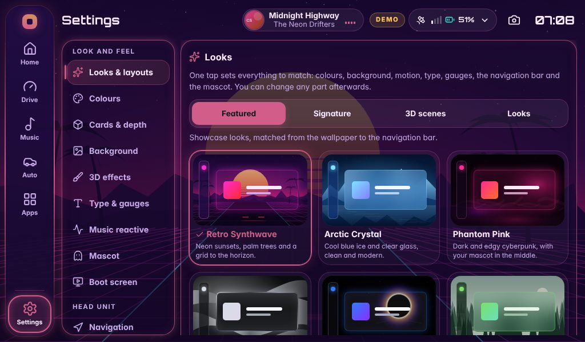
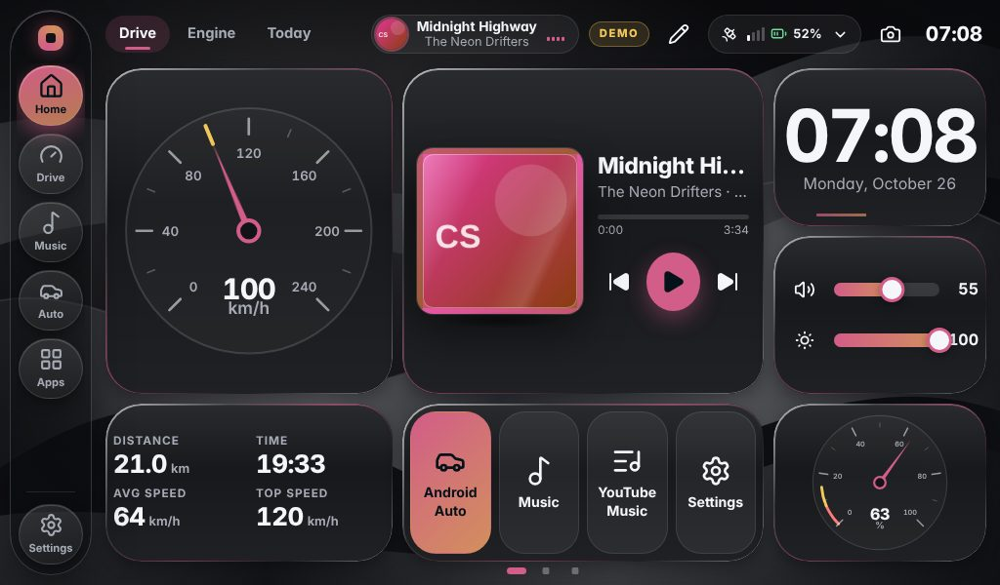

# Themes, looks and layouts

Everything about how RootUnit looks lives in **Settings**, in the *Look and feel* group down the left. Every change shows at once and is
saved straight away: there is no Save button (the boot screen is the one exception, see [mascot-boot.md](mascot-boot.md)).

## One tap: looks

**Settings → Looks & layouts** sets colours, wallpaper, card style, depth, glass, motion, typeface, page transitions, gauges, the
navigation bar's style and the mascot's motion and light **together**, so nothing clashes. Each tile is a live miniature of the real
combination, not a screenshot. Change any single part afterwards and the rest stays as it was.

| Kind | Looks |
| --- | --- |
| **Featured** (6) | Retro Synthwave · Arctic Crystal · Phantom Pink · Liquid Chrome · Stealth AMOLED · Nature Drive |
| **Signature** (25) | RootUnit · Plague Doctor · Tokyo Drift · Replicant · Digital Rain · Retro Terminal · Vaporwave · Deep Space · Nebula · Ocean Breeze · Lava Lounge · Blueprint Lab · Moonlight · Night Vision · Track Day · Gothic · Workshop · Cobalt Code · Aurora Lake · Golden Hour · First Snow · Cherry Blossom · Café · Lavender Fields · Concrete Jungle |
| **3D scenes** (16, from v2) | Cyber Neon · Ocean Glass · Vinyl Lounge · Aurora 3D · Night Racer · AMOLED Eclipse · Sunset GT · Focus HUD · Crystal Palace · Silver Grid · Emerald Matrix · Galaxy Purple · Arctic Ice · Ruby Glass · Copper Retro · Hyperdrive |
| **Looks** (14, from v2) | Classic · Glass Night · Album Immersion · Ambient · Neon Drive · Sunset Cruise · Forest Retreat · Ocean Deep · Racing Red · Gold Standard · Daylight Clean · Paper Glass · Sun Glare · Night Shift |

v2's sixteen 3D scenes keep their v2 values and also get a matching typeface, transition, gauge, navigation style, touch effect and
mascot motion. v2's *Liquid Chrome* scene is now called **Silver Grid**, because **Liquid Chrome** is a new featured look.

| | |
| --- | --- |
|  |  |
| **Retro Synthwave** with *Player focus* | **Arctic Crystal** with *Glass hub* |
|  |  |
| **Phantom Pink** with *Cockpit* | **Liquid Chrome** with *Classic* |

## Home layouts

Further down the same page. A layout replaces the Home dashboard's first page and keeps the *Engine* page. Tap twice to use one
(the first tap asks).

| Layout | What is on it |
| --- | --- |
| **Cockpit** | A big player with your mascot, the clock and weather, and the car, FM and shortcuts underneath |
| **Player focus** | Just the music: the artwork big, the controls, nothing else |
| **Glass hub** | Player, clock and weather, and shortcuts, with room on the right for your mascot |
| **Classic** | Speed, music, clock and quick controls: the layout it came with |

A layout also moves the mascot so it never appears twice or covers a widget: it is switched off where the player card already holds
it, and placed behind the widgets in the space left for it otherwise. After that, Home → pencil edits widgets as usual.

## Every part on its own

| Section | What you can choose |
| --- | --- |
| **Looks & layouts** | The looks and layouts above; the accent colour (8 swatches, or any colour with *Hue* and *Lightness*); *colour the interface from the album art*; **Reset the look** |
| **Colours** | 36 palettes (below); a day palette and a night palette, switched by the clock or by the real sunrise and sunset |
| **Cards & depth** | Card style: Solid · Glass · Outline · Neon · Clay · HUD · Chrome · Aero. Depth: Flat · Soft · Deep · Crystal · Floating · Bevel · Layered. Glass finish: Clear · Frosted · Prismatic · Iridescent · Smoked · Liquid, and how see-through it is. Corners: Sharp · Soft · Round |
| **Background** | None · Album blur · Album cover · Ambient · Aurora · Gradient · Grid · Carbon · Wallpaper · Mesh · Stars · Hexagons · Topographic · Circuit · Dots · Waves · Synth sun · Bokeh · Scanlines; 20 built-in wallpapers and your own pictures; dim and blur; an animated scene behind the widgets (below); real weather in the scene |
| **3D effects** | Effects level; motion intensity (Off · Calm · Lively · Cinematic); album glow, background motion and particle switches; 15 artwork styles; 8 page transitions; touch feedback (None · Ripple · Glow · Pop). See [3d-motion.md](3d-motion.md) |
| **Type & gauges** | Typeface: Inter · System · Grotesk · Outfit · Rounded · Tech · Future · Mono; text size; gauges: Arc · Needle · Digital · Ring · Bar · Sport; standby screen: Clock · Analog · Flip · Mascot · Orbit · Minimal |
| **Music reactive** | Off · Glow · Wash · Rings · Spectrum · Edges · Halo · Burst · Wave · Radial, coloured by Accent · Album · Rainbow · Custom · Heat. See [music-reactive.md](music-reactive.md) |
| **Mascot** | Original · Neon cut-out · 3D armour; 11 motions; 5 auras. See [mascot.md](mascot.md) |
| **Boot screen** | The start-up screen. See [mascot-boot.md](mascot-boot.md) |

The navigation bar's ten styles and three positions are under **Settings → Navigation → Edit navigation… → Look**
([navigation.md](navigation.md)).

**Animated scenes:** Off · Glow · Orbits · Grid · Particles · Warp · Waves · Rain · Fireflies · Matrix · Nebula · Snow · Lava · Rings ·
Comets · Bubbles · Tunnel · Synth sun · Circuit.

**Built-in wallpapers:** Night road · City lights · Mountains · Dunes · Waves · Neon city · Galaxy · Pine forest · Coast road · Canyon ·
Tunnel · Race track · Aurora lake · Synthwave sunset · Ice peaks · Liquid chrome · Phantom smoke · Eclipse · Vinyl lounge · Sunset GT.
They are drawn as SVG in the app, so they cost no download and stay sharp on any screen.

**The accent is always readable.** A colour that would be too faint against the palette in force (under 3:1) is lightened or
darkened just enough; the sample under the sliders shows the colour in use, its contrast, and says when it was adjusted.

**Reset the look** (two taps, at the bottom of Looks & layouts) puts every colour, card, background, motion, type, mascot and
navigation-style setting back as it came. Units, music, text size, your navigation buttons and your Home pages stay as they are.

## Palettes

| Dark (26) | | Light (8) | High visibility (2) |
| --- | --- | --- | --- |
| Obsidian · Midnight · Carbon · AMOLED · Ember · Ocean · Forest · Aurora · Synthwave · Nord · Mocha · Crimson · Royal | Neon Plague · Tokyo Night · Vampire · Matrix · Night City · Amber CRT · Night Red · Sunset · Cobalt · Gunmetal · Lunar · Velvet · Blueprint | Daylight · Sand · Mint · Sakura · Lavender · Arctic · Latte · Concrete | High contrast · Sunlit |

Day and night switching changes the **palette** only; your card style, background and everything else stay.

## Backgrounds that use the album art

*Album blur*, *Album cover* and *Ambient* use the cover of what is playing (the station logo while radio plays; for YouTube Music and
TIDAL, the track you selected). When nothing is playing they fall back to a gradient built from your accent colour, so the screen is
never blank.

**Text stays readable by construction.** The background is darkened (or lightened on light palettes) by at least as much as the
*actual* picture needs: the app measures how bright the cover is and works out the smallest dim that keeps every text colour above its
contrast target (4.5:1, or 7:1 on the two high-visibility palettes). If the brightness cannot be measured, it uses the palette's
worst-case dim, which is always safe. The *Dim* slider only adds dimming on top of that.

## Your own wallpapers

**Settings → Background → Wallpapers → Add your own picture** uploads a picture from the head unit's screen, or from a phone or laptop
that has the head unit's page open, and chooses it. Or copy files into the folder yourself:

* The folder is `data/wallpapers/` (next to `settings.json`), or `HEADUNIT_WALLPAPER_DIR` in `.env`.
* PNG, JPG/JPEG, WebP or AVIF, up to 12 MB each; the picker lists the first 100 by name. SVG and HTML are refused on purpose.
* File names start with a letter or digit, then letters, digits, `.` `_` `-` or spaces; at most 100 characters; no `..`. An upload
  never overwrites an existing file.
* New files appear the next time you open the picker; no restart. Around 1920×1080 is plenty: a huge original only costs memory.
* Only real files directly inside the folder are served. Shortcuts (symlinks) and sub-folders are ignored, and no request can reach
  outside the folder.

## Effects levels and the Raspberry Pi

The look is built to be cheap on a Pi 5:

* **Minimal**: no blur and no animation. Choose this if the screen ever feels slow.
* **Balanced** (default): one softly blurred background layer and gentle motion. "Glass" cards are translucent over that one layer,
  so there is a single blur on screen.
* **Full**: adds a true frosted `backdrop-filter` behind glass cards. Uses more GPU.
* *Motion intensity → Off* stops every decorative animation at any level, and so does the system's *reduce motion* setting.
* Only `transform` and `opacity` ever animate. Decorative motion stops while the car moves; only the turning record or CD and the
  music equaliser keep going.

## For developers

* Palettes live in `apps/ui/src/lib/themes/` (`core.ts`, `groupA.ts` … `groupE.ts`). Each is a full token set (`Palette` in
  `types.ts`) applied as CSS variables on `<html>` by `applyAppearance()` (`apply.ts`), which also sets the `data-*` attributes the
  styles key on (`data-surface`, `data-depth`, `data-glass`, `data-font` and so on).
* The tests check **every** palette: all tokens present, WCAG contrast of text, dim, accent and status colours, glass and card fills
  over the worst-case picture, and that no palette is a recolour of another. To add one: add its id to `THEME_IDS`
  (`packages/shared/src/appearance.ts`), write it with `definePalette()`, and run `npm test -w @headunit/ui`.
* Looks are in `lib/themes/presets.ts`, layouts in `lib/layoutPresets.ts`, and every option's name and one-line description in
  `lib/appearanceInfo.ts`.
* `styles/policy.test.ts` guards the Pi's performance across all the CSS: keyframes may only animate transform and opacity, nothing
  transitions layout, `filter` is confined to the background layers, `backdrop-filter` only through `--surface-blur`, every
  `var(--x)` is defined, every animation names a keyframe that exists, and decorative motion (`.fx`) stops while driving.
* The server validates every setting; unknown or out-of-range values are ignored or clamped.
